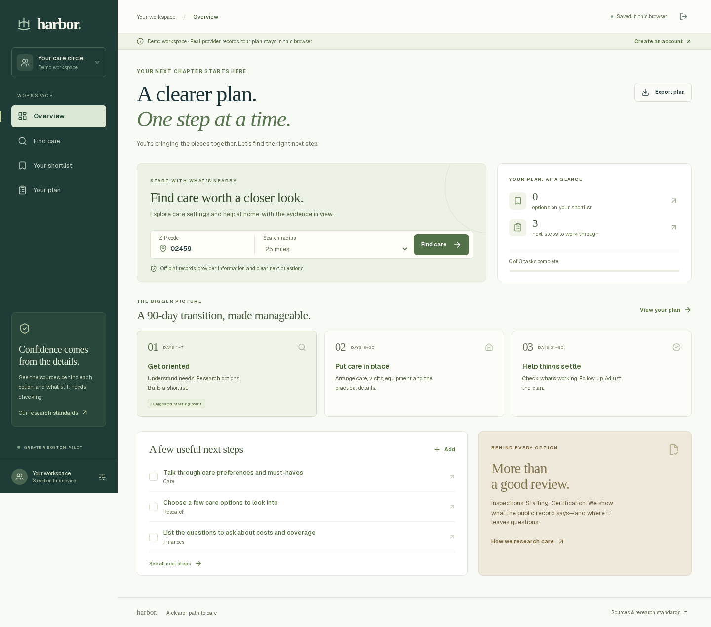

# Harbor

A Greater Boston elder-care research and coordination proof of concept. Families can search by ZIP and radius, inspect public evidence, compare resources, save a shortlist, and build a transition plan.

**Status:** the POC opens directly into a browser-local workspace, with no app sign-in required. Source is published to GitHub and a protected Vercel preview is available. Shortlists, notes and tasks stay in the current browser; export is available. Accounts are deliberately disabled for this phase. See [the verification record](docs/verification.md) for the latest hosted checks.



## What is built

- Public landing page and immediate dashboard access. Account screens and care-preferences setup are retained for a later activation.
- A family dashboard with a 90-day planning outline, saved options and next steps.
- Real ZIP/radius search across 521 resource records: 280 nursing homes, 224 assisted-living residences, 10 home-service organizations and 7 continuing-care campuses.
- List and map views, care-category filters, name/town search and nursing-home-only CMS rating order.
- Source links, source dates, published staffing metrics, actual CMS inspection findings and penalty events, explicit unknowns and provider follow-up questions.
- CMS home-health clinical-quality ratings and patient surveys for seven certified agencies across six organizations, with response counts, response rates, five experience measures and separate clinical measures.
- Location details for 86 providers, published prices with billing periods at 35, and dated observations of public opening and waitlist claims.
- Public review evidence at 17 locations, with six provisional consumer experience scores out of ten. Source links, exclusions and limited-coverage labels accompany the scores.
- Research filters, category-specific consumer-score sorting, and separate Life here, Rooms & costs, Availability and Reviews tabs.
- Three-option comparison, research notes, task creation/completion/deletion and Markdown plan export.
- A configured Supabase database with owner-only access. Account UI is off by default; no service-role key is used by the app.
- A private research collection service with a 521-record registry, source coverage, daily CMS checks, retries, request budgets and a review queue. A bounded Yelp evaluation checks listing identity and API access without retaining review content.
- A strict CSV importer for Facebook research batches. The first 71-observation pilot is privately staged for review; it has not changed public evidence or scores.

Published offerings and consumer reviews are a research snapshot. Current vacancies and personalized prices still require confirmation. Individual caregivers have not been vetted, reference checks have not been completed, and no automated social-review feeds are connected. The consumer experience index summarizes eligible published ratings; clinical and regulatory evidence remains separate. See [location research coverage](docs/location-research.md) and [the score policy](docs/experience-score.md).

Collection setup and operating queries are in [research automation](docs/research-automation.md). Read [the Facebook pilot review](docs/facebook-pilot-review.md) before using that batch, and [data access](docs/data-access.md) for the requirements and inquiry draft for licensed review analysis.

## Run locally

Requires Node 24 and npm. All npm dependencies are locked in `package-lock.json`.

```bash
npm ci
npm run dev
```

Open `http://localhost:3000`, then choose **Open your care workspace**. Or open `http://localhost:3000/dashboard` directly. No secrets are needed for provider research and the demo plan. Demo storage uses `harbor.demo.workspace.v1`; clearing browser storage removes it. Real-account state is never written to that storage key.

For a production-mode local check:

```bash
npm run build
npm run start
```

Do not run a fresh build while serving the previous `.next` build from the same directory. Stop the server, build, then start it again.

## Activate accounts later

`NEXT_PUBLIC_ENABLE_ACCOUNTS` defaults to false. In this mode, signup/login links are hidden and their URLs redirect into the local demo. Keep it off while testing the current POC. A dedicated Supabase project is already provisioned for this repository; the steps below also describe setup for a fresh copy.

1. Select a **new, dedicated Supabase project**. Inspect its schema before applying SQL. Do not apply this app's schema to an unrelated project.
2. Review and run `supabase/schema.sql` once. It creates `user_workspaces`, enables RLS, and grants authenticated users access only to their own row. Policies are deliberately not blindly reapplied.
3. Copy `.env.example` to `.env.local` and set the project's URL and publishable key. The publishable key is designed for client use. Never substitute a secret/service-role key.
4. Configure the Supabase Site URL and allowed callback URL for the exact app origin, including `http://localhost:3000/auth/callback` for development and the deployed HTTPS callback for production.
5. Keep email confirmation enabled. Configure a production email sender before opening signup beyond Supabase's default email restrictions. Confirm that delivery, callback, session refresh and sign-out actually work.
6. Add the same two environment variables to the intended Vercel environment, then rebuild. `NEXT_PUBLIC_` values are compiled into client bundles.
7. Run the live-account verification checklist in `docs/verification.md`. Static code review and a local demo do not prove a hosted auth setup works.
8. Only after those checks, set `NEXT_PUBLIC_ENABLE_ACCOUNTS=true` in the intended environment and rebuild to expose the account flow.

The app fails closed when account infrastructure is unavailable. Signup is disabled with a clear explanation; `/api/workspace` returns 503. Anonymous calls return 401 once configured. Personal responses are `private, no-store`; writes validate browser origin, payload size and every accepted field. Owner identity comes from `auth.getUser()`, not a submitted user ID or editable metadata.

## Data and ordering

The catalog is a **November 11, 2026 research snapshot**. CMS nursing-home processing date is October 1; its release date is October 28. Massachusetts directory records and the June 25 certified-residence spreadsheet are separate evidence. Home-health records and agency websites have their own dates.

Facility coverage is Massachusetts locations within 55 straight-line miles of central Boston. Search origins are Massachusetts ZIPs inside that pilot region, and the selectable radius is 1–50 miles. A search near the boundary is clipped by the catalog's coverage; no result is not proof that no care exists.

Distances use published Census/GeoNames ZIP points, not an exact home location or driving time. Home-service distances refer to offices, not confirmed service availability. One agency without a reliable coordinate remains in the catalog but is excluded from radius and map results. Two continuing-care campuses use explicitly labeled published Census ZIP-area estimates, not borrowed nursing-unit coordinates. Categories keep each record’s primary service; four agencies with documented private-care services also appear under Help at home. Campus and licensed-unit records are separate resources, not a count of unique parent organizations.

Default order is distance. Nursing-home searches can sort by published CMS overall rating, with missing ratings last and distance/name/ID as tie-breakers. Assisted living and home services never receive CMS nursing-home stars. Counts, zero values and missing values stay distinct.

Within a selected care category, families can also sort by the consumer experience index. At least ten eligible reported reviews are required. Missing scores sort after rated records without becoming zeroes. Source-family deduplication, freshness checks and exclusions are described in the score policy.

Read [`docs/data-sources.md`](docs/data-sources.md) for provenance, licenses, field meanings and known gaps. GeoNames postal data is used under CC BY 4.0; Census coordinates are US government data. Maps credit OpenStreetMap contributors.

```bash
python scripts/prepare-data.py
python scripts/prepare-inspections.py
python scripts/prepare-home-health.py
python scripts/prepare-location-research.py
```

This rebuilds the catalog from retained, reviewed input snapshots. It does not refresh upstream sources or change their dates. Review source changes and matching before replacing those inputs. Do not change a retrieval date without retrieving the underlying source.

## Checks

```bash
npm run lint
npm run test
npm run build
npm run test:e2e
```

For E2E tests, start the production server first, or use `PLAYWRIGHT_START_SERVER=1 npm run test:e2e`. Install the browser once with `npx playwright install chromium`. Desktop and mobile cases use the actual provider API and data.

`node scripts/check-accessibility.mjs` checks public and demo screens with axe against a running server and writes a local report under `artifacts/`.
`node scripts/check-location-research.mjs` checks the four research sections on desktop and mobile, verifies the close control after scrolling, and captures review/price screenshots.

## Structure

- `src/lib/search.ts`: geographic validation, filtering and deterministic order.
- `src/data/`: sourced catalog, retained input records and ZIP provenance.
- `src/components/`: dashboard, provider evidence, map and auth screens.
- `src/hooks/use-workspace.ts`: separate local-demo and cloud persistence paths.
- `src/app/api/workspace/`: authenticated workspace reads/writes.
- `supabase/schema.sql`: database setup and owner policies, applied to the dedicated Harbor project.
- `supabase/research-*.sql` and `supabase/functions/`: private collection queue, single-use worker authentication, CMS collector and Yelp capability checks.
- `scripts/import-research.ts`: dry-run validation and optional private staging of research-kit CSVs.
- `tests/`: data, security-boundary and browser-flow tests.

## Current boundaries

This is a personal research workspace. Multi-person invitations, staff operations, appointment booking, outreach, payments and clinical record uploads are not implemented. A full-document workspace save is last-write-wins across devices; the UI serializes saves within a session. Multi-user collaboration needs revisions and conflict handling before it is enabled.

The product does not diagnose care needs, confirm suitability or promise that a provider is safe. See [`docs/quality-roadmap.md`](docs/quality-roadmap.md) for the next evidence and workflow milestones.
