# Architecture

Harbor is a Next.js application with a browser-local family workspace, server-side search over reviewed snapshots, and a separate private research collector. The public app does not read unreviewed collection results.

```mermaid
flowchart LR
  Inputs[Reviewed source inputs] --> Rebuild[Offline Python rebuilds]
  Rebuild --> Snapshots[Application JSON snapshots]
  Snapshots --> Search[Search and evidence modules]
  Search --> Routes[Read-only Next routes]
  Routes --> Dashboard[Care search and provider details]
  Dashboard <--> Workspace[Browser-local plan]
  CMS[Official CMS sources] --> Worker[Private scheduled collector]
  Worker --> Queue[Snapshots and review candidates]
  Queue -. editorial review .-> Inputs
```

## Family workflow

`src/app/dashboard/page.tsx` selects the browser-local flow while accounts are disabled. `Dashboard` waits for the workspace to initialize, then coordinates navigation and actions shared by the views.

The modules under `src/components/dashboard/` own search, overview, shortlist, plan and dialogs. Search request state lives in `use-care-search`; it separates form edits from submitted filters and cancels superseded requests. `use-saved-providers` resolves the shortlist's IDs to current catalog records. The workspace remains the source of truth for saved IDs and notes when that lookup is loading or fails.

`use-workspace` validates every change before storing it. A failed browser write does not claim a save succeeded. The browser loads the Supabase SDK when a cloud account action requests a client. Account-backed persistence has separate server-side identity checks and row-level access controls.

Provider cards show the information needed to choose which options to investigate. Details expose source-linked offerings, costs, availability, consumer reviews, Facebook findings and applicable CMS evidence. Location research and home-health panels share a request hook that checks the returned provider ID, cancels superseded requests and supports retry. The provider detail disclosure preserves the complete list of source-reported services. Material care warnings remain visible on cards.

## Search and evidence

| Module                         | Responsibility and test surface                                                                                                                                              |
| ------------------------------ | ---------------------------------------------------------------------------------------------------------------------------------------------------------------------------- |
| `src/lib/search.ts`            | Validates ZIP, radius, care category and sorting; returns actual catalog matches. Search tests verify geography, missing values and category constraints.                    |
| `src/lib/location-research.ts` | Builds one provider's research response and compact search summary. Tests verify exact source provenance and exclusions.                                                     |
| `src/lib/experience-score.ts`  | Computes the experience score from eligible aggregates, freshness and source families. Its policy and tests are separate from UI layout.                                     |
| `src/lib/inspections.ts`       | Returns bounded inspection and penalty history for an allowlisted nursing-home CCN.                                                                                          |
| `src/lib/home-health.ts`       | Keeps agency clinical measures and patient surveys separate, including periods, units and suppression.                                                                       |
| `src/lib/facebook-research.ts` | Supplies the curated qualitative projection and deduplicates eligible original threads into separate family-experience evidence. It does not feed numeric score calculation. |
| `src/lib/research-coverage.ts` | Produces a complete catalog checklist with missing-score reasons and a spreadsheet-safe CSV export.                                                                          |
| `src/lib/workspace.ts`         | Validates the complete plan and its limits; callers do not bypass that validation.                                                                                           |

The route handlers under `src/app/api/` validate request shape and delegate to these modules. They are intentionally small. The published registry indexes stable provider IDs once for search and coverage lookups. The scorer evaluates freshness against the requested date, defaulting to the current UTC date.

`location-research` exposes the same optional `familyExperience` object in detail and compact research. It counts only editorially released exact-provider resident-family findings with recognized original thread links. Missing coverage stays unsearched, distinct from a covered zero. Search uses this qualitative count only to break equal non-null numeric experience scores within the selected care category. Unrated, unequal-score, distance and CMS ordering remain unchanged. Cards and detail disclose the selected scope and lack of prevalence or positivity inference. See [the experience policy](experience-score.md#family-experience-evidence-and-tie-only-ordering).

## Research collection and publication

The scripts under `scripts/prepare-*.py` rebuild snapshots offline from retained inputs. Provider address corrections are explicit records with original values and source provenance. A rebuild fails when a correction no longer matches its expected original record.

`src/lib/research-pipeline/import.ts` validates external CSV batches and prepares private staging results. Its larger implementation stays together because the validation rules form one cohesive import contract; splitting it into generic parsing wrappers would make that contract harder to follow.

The Deno function under `supabase/functions/research-collector/` claims jobs through private database functions. The SQL files enforce leases, budgets, snapshot hashes, review state and short-lived invocation tickets. These functions are not public app endpoints. Yelp remains disabled; no cleanup change enables a paid source.

Collection does not publish evidence. Review the exact care unit, source, date and meaning before updating application inputs. `prepare-research-registry.py` generates an initial seed with conflict-preserving inserts, not an ongoing sync of catalog edits or coverage.

## Verification

Unit and actual local PostgreSQL tests cover domain behavior and database rules. Playwright covers desktop/mobile flows against the built app, including failed requests, wrong-location evidence, storage failures and export. Knip checks unused exports and dependencies, including standalone tools and the separately deployed Deno entrypoint. See [CONTRIBUTING](../CONTRIBUTING.md) for commands and [verification](verification.md) for observed results.
